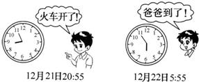

# Mathematics (Grade 3)

**ID**: 6a04ce3c
**难度**: medium_hard
**题型**: short_answer

## 题目
爸爸坐火车从武昌站到北京西站，火车平均每小时可以行120千米．

（1）爸爸从武昌站到北京西站一共用了多少小时？
（2）武昌站到北京西站的铁路路线长多少千米？

## 解答

**答案**: 9, 1080

1. Step1:计算12月21日20:55到24:00所经过的时间，24：00 - 20：55 = 3小时5分钟
2. Step2:将12月21日20:55到24:00所经过的3小时5分钟与12月22日0:00到5:55所经过的5小时55分钟相加，3小时5分 + 5小时55分钟 = 9小时，得到爸爸从武昌站到北京西站一共用的时间
3. Step3:已知火车平均每小时行120千米，用速度120千米/小时乘以所用时间9小时，120×9 = 1080千米，得到武昌站到北京西站的铁路路线长

## 知识点

**知识点**:
  - 简单的行程问题．

---
