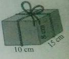

# Mathematics (Grade 3)

**ID**: 6d4cfcb1
**难度**: medium_hard
**题型**: short_answer

## 题目
用一根绳子捆扎一个礼盒。如果接头处长25厘米，捆扎这个礼盒至少需要多少厘米的绳子？

 10cm  8cm  15cm

## 解答

**答案**: 91(厘米)

1. Step1:明确礼盒上绳子长度的组成，有两个15厘米、两个10厘米、两个8厘米
2. Step2:计算15厘米、10厘米、8厘米长度绳子的总长度，即(15 + 10 + 8)×2 = 66厘米
3. Step3:加上接头处的长度25厘米，66 + 25 = 91厘米

## 知识点

**知识点**:
  - --

---
