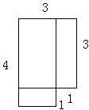

# Mathematics (Grade 3)

**ID**: 74421dd7
**难度**: medium_hard
**题型**: short_answer

## 题目
如图，一张长为4厘米，宽为2厘米的长方形与一张边长为3厘米的正方形纸叠放起来．这个叠放成的图形的周长是多少？

## 解答

**答案**: 14

1. Step1:明确正方形边长为3厘米，长方形长4厘米、宽2厘米
2. Step2:分析得出叠放图形的周长组成部分为正方形的3条边加上3条1厘米的边和1条2厘米的边
3. Step3:计算正方形3条边的长度为3×3 = 9厘米
4. Step4:计算3条1厘米边的长度为1×3 = 3厘米
5. Step5:将各部分长度相加，即9 + 3 + 2 = 14厘米

## 知识点

**知识点**:
  - 重叠问题

---
