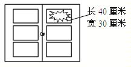

# Mathematics (Grade 3)

**ID**: 78b4f9db
**难度**: medium_hard
**题型**: short_answer

## 题目
教室窗户的一页玻璃碎了，需要更换（如图）．
（1）需要更换的玻璃的面积有多大？
（2）为使玻璃牢固，要在每页玻璃的四周钉上木条，每页玻璃需多长的木条？

## 解答

**答案**: 1200, 140

1. Step1:根据长方形面积公式，已知玻璃长40厘米，宽30厘米，计算面积为40×30=1200平方厘米
2. Step2:根据长方形周长公式，计算玻璃周长为(40+30)×2=140厘米

## 知识点

**知识点**:
  - 长方形、正方形的面积；长方形的周长．

---
