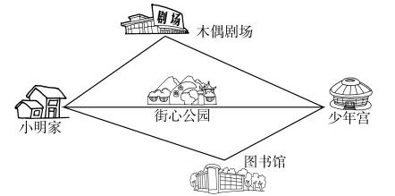

# Mathematics (Grade 3)

**ID**: 7b0a35c9
**难度**: medium_hard
**题型**: short_answer

## 题目
看图找路线。

小明家到少年宫有几条路线？ 其中最近的是哪条路线？

## 解答

**答案**: 3, 小明家→街心公园→少年宫

1. Step1:明确小明家到少年宫的路线有小明家→木偶剧院→少年宫，小明家→街心公园→少年宫，小明家→图书室→少年宫这三条
2. Step2:根据“两点之间，线段最短”的原理，判断出小明家→街心公园→少年宫这条路线是最近的
3. Step3:数出路线的数量为3条，确定最近路线为小明家→街心公园→少年宫

## 知识点

**知识点**:
  - 路线图;最短路线问题(奥数)

---
