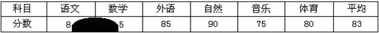

# Mathematics (Grade 3)

**ID**: 7b230580
**难度**: medium_hard
**题型**: short_answer

## 题目
王华的期末考试成绩单被弄污了， 有两个数字看不清，请你想办法把语文、数学成绩计算出来．

## 解答

**答案**: 83, 85

1. Step1:根据平均成绩为83分，计算六门成绩的总成绩，83×6=498分
2. Step2:用总成绩减去已知四门科目的成绩，即498 - 85 - 90 - 75 - 80 = 168分，得到语文和数学两门科目的总成绩
3. Step3:因为数学成绩个位数字是5，用两门总成绩个位数字8减去5，8 - 5 = 3，推出语文成绩个位数字是3，从而得出语文成绩为83分
4. Step4:用语文和数学的总成绩168分减去语文成绩83分，168 - 83 = 85分，得出数学成绩为85分

## 知识点

**知识点**:
  - 平均数的含义及求平均数的方法．

---
