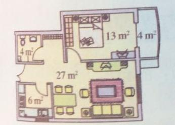

# Mathematics (Grade 3)

**ID**: 7bdc420e
**难度**: medium_hard
**题型**: short_answer

## 题目
下面是一室、一厅、一卫的楼房的平面图.
 （1）用边长5分米的正方形地砖铺设厨房和卫生间，需要多少块地砖？
 解答：( )
 （2）用每平方米250元的木地板铺设卧室和客厅，需要花多少钱？
 （3）你还能提出什么问题？

 4,6,27,13,4

## 解答

**答案**: 63, 10000

1. Step1:将厨房和卫生间的面积单位由平方米换算为平方分米，因为1平方米 = 100平方分米，所以4平方米换算后为4×100 = 400平方分米，6平方米换算后为6×100 = 600平方分米
2. Step2:计算一块正方形地砖的面积，已知地砖边长为5分米，根据正方形面积 = 边长×边长，可得一块地砖面积为5×5 = 25平方分米
3. Step3:计算厨房和卫生间的总面积为400 + 600 = 1000平方分米
4. Step4:用厨房和卫生间的总面积除以一块地砖的面积，得到所需地砖数量为1000÷25 = 40块
5. Step5:计算卧室和客厅的总面积为13 + 27 = 40平方米
6. Step6:已知木地板每平方米250元，用卧室和客厅的总面积乘以每平方米木地板的价格，可得铺设木地板所需费用为40×250 = 10000元

## 知识点

**知识点**:
  - --

---
