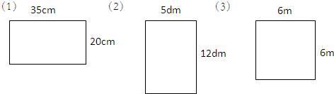

# Mathematics (Grade 3)

**ID**: 7c279229
**难度**: medium_hard
**题型**: short_answer

## 题目
计算各图面积．

## 解答

**答案**: 700, 60, 36

1. Step1:对于第一个长方形，长为35cm，宽为20cm，根据长方形面积公式S=ab（a为长，b为宽），可得面积为35×20=700平方厘米
2. Step2:对于第二个长方形，长为12dm，宽为5dm，根据长方形面积公式S=ab，可得面积为12×5=60平方分米
3. Step3:对于第三个正方形，边长为6m，根据正方形面积公式S=a×a（a为边长），可得面积为6×6=36平方米
4. Step4:将三个图形的面积按顺序整理为['700', '60', '36']

## 知识点

**知识点**:
  - 长方形、正方形的面积．

---
