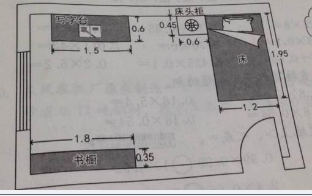

# Mathematics (Grade 3)

**ID**: 80e446f0
**难度**: medium_hard
**题型**: short_answer

## 题目
聪聪房间摆放的家具的尺寸如下：（单位：米）
 聪聪房间的家具占地面积各是多少平方米？

 0.6 1.5 0.45 0.6 1.95 1.2 1.8 0.35

## 解答

**答案**: 0.9, 0.63, 0.27, 2.34

1. Step1:根据长方形面积公式，写字台为长方形，长1.5米，宽0.6米，其面积为0.6×1.5 = 0.9平方米
2. Step2:书橱为长方形，长1.8米，宽0.35米，其面积为1.8×0.35 = 0.63平方米
3. Step3:床头柜为长方形，长0.6米，宽0.45米，其面积为0.6×0.45 = 0.27平方米
4. Step4:床为长方形，长1.95米，宽1.2米，其面积为1.2×1.95 = 2.34平方米

## 知识点

**知识点**:
  - --

---
