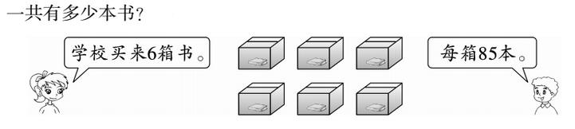

# Mathematics (Grade 3)

**ID**: 85def220
**难度**: medium_hard
**题型**: short_answer

## 题目

一共有多少本书？
学校买来6箱书。
每箱85本。

## 解答

**答案**: 510

1. Step1:明确已知条件为学校买来6箱书，每箱85本
2. Step2:分析得出求书的总数就是求6个85本的和
3. Step3:根据乘法的意义，确定用乘法计算，列式为85×6
4. Step4:计算85×6的结果为510本

## 知识点

**知识点**:
  - 整数乘法应用题

---
