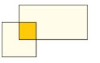

# Mathematics (Grade 3)

**ID**: 86b1b799
**难度**: medium_hard
**题型**: short_answer

## 题目
图中阴影部分的面积占大长方形面积的$\frac{1}{8}$，占大正方形面积的$\frac{1}{4}$，则大正方形的面积是大长方形面积的几分之几？

## 解答

**答案**: $\frac{1}{2}$

1. Step1:设阴影部分的面积为1
2. Step2:因为阴影部分面积占大长方形面积的1/8，所以大长方形面积为1÷(1/8)=8
3. Step3:因为阴影部分面积占大正方形面积的1/4，所以大正方形面积为1÷(1/4)=4
4. Step4:计算大正方形面积是大长方形面积的几分之几，即4÷8=4/8=1/2

## 知识点

**知识点**:
  - 分数的初步认识

---
