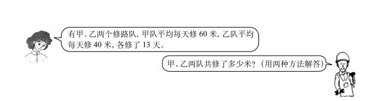

# Mathematics (Grade 3)

**ID**: 8ad35c51
**难度**: medium_hard
**题型**: short_answer

## 题目

有甲、乙两个修路队，甲队平均每天修60米，乙队平均每天修40米，各修了13天。甲、乙两队共修了多少米？（用两种方法解答）

## 解答

**答案**: 1300

1. Step1:根据方法一的思路，先计算甲、乙两队平均每天一共修的长度，即60 + 40 = 100米
2. Step2:将甲、乙两队平均每天一共修的长度乘以天数13，可得(60 + 40)×13 = 100×13 = 1300米
3. Step3:根据方法二的思路，先计算甲队13天修的长度，即60×13 = 780米
4. Step4:计算乙队13天修的长度，即40×13 = 520米
5. Step5:将甲队和乙队13天修的长度相加，即60×13 + 40×13 = 780 + 520 = 1300米

## 知识点

**知识点**:
  - 简单的工程问题;整数复合应用题

---
