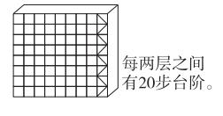

# Mathematics (Grade 3)

**ID**: 8dcf13b9
**难度**: medium_hard
**题型**: short_answer

## 题目
刘强从一楼回到家，他走了140个台阶， 他家住几楼？

## 解答

**答案**: 8

1. Step1:已知每两层之间有20个台阶，刘强走了140个台阶，用总台阶数除以每两层之间的台阶数，即140÷20，可求出间隔数为7个。
2. Step2:因为从一楼开始走，根据楼层数 = 1 + 间隔数，所以刘强家所在楼层为1 + 7 = 8楼。

## 知识点

**知识点**:
  - 植树问题之开放型两端都种(奥数)

---
