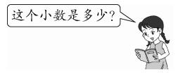

# Mathematics (Grade 3)

**ID**: 8fcbd666
**难度**: medium_hard
**题型**: short_answer

## 题目
有一个小数，百分位上的数字是个位上数字的5倍，十分位上的数字等于百分位上的数字与个位上数字的和。

## 解答

**答案**: 1.65

1. Step1:因为百分位上的数字是个位上数字的5倍，且各个数位上的数字只能是0 - 9的整数，所以个位上的数字只能是1，百分位上的数字是5
2. Step2:根据十分位上的数字等于百分位上的数字与个位上数字的和，计算出十分位上的数字为5 + 1 = 6
3. Step3:根据个位数字是1，十分位数字是6，百分位数字是5，得出这个小数是1.65

## 知识点

**知识点**:
  - 小数的认识

---
