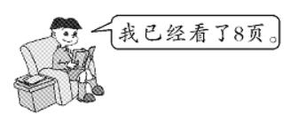

# Mathematics (Grade 3)

**ID**: 91c579cb
**难度**: medium_hard
**题型**: short_answer

## 题目
小永看故事书。

（1）剩下的页数是看完页数的8倍，剩下多少页没看？
（2）这本故事书一共有多少页？

## 解答

**答案**: 64, 72

1. Step1:已知已经看了8页，根据剩下的页数=看完的页数×8，可得剩下的页数为8×8=64页
2. Step2:根据加法的意义，用剩下的页数64页加上看完的页数8页，即64 + 8 = 72页，得到这本故事书一共的页数

## 知识点

**知识点**:
  - 表内乘法

---
