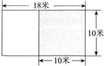

# Mathematics (Grade 3)

**ID**: 92581b13
**难度**: medium_hard
**题型**: short_answer

## 题目
在一块长方形菜地里，划出一块边长为10米的正方形菜地种白菜．
（1）种白菜的面积是多少平方米？
（2）剩下部分是什么图形？面积是多少平方米？

## 解答

**答案**: 100, 80

1. Step1:根据正方形面积公式S=a²，其中a = 10米，可得种白菜的面积为10×10 = 100平方米
2. Step2:计算长方形菜地的宽为18 - 10 = 8米，可知剩下部分是长10米，宽8米的长方形
3. Step3:根据长方形面积公式S = ab，其中a = 10米，b = 8米，可得剩下部分面积为10×8 = 80平方米

## 知识点

**知识点**:
  - 长方形、正方形的面积．

---
