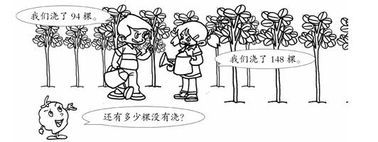

# Mathematics (Grade 3)

**ID**: 96025ada
**难度**: medium_hard
**题型**: short_answer

## 题目
同学们要给植物园的500棵小树浇水。

同学们要给植物园的500棵小树浇水。
我们浇了94棵。
我们浇了148棵。
还有多少棵没有浇？

## 解答

**答案**: 258

1. Step1:计算已经浇水的总数，94 + 148 = 242（棵）
2. Step2:用小树的总棵数减去已经浇水的总数，500 - 242 = 258（棵）

## 知识点

**知识点**:
  - 整数的加法和减法

---
