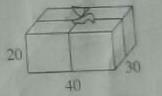

# Mathematics (Grade 3)

**ID**: 9d403903
**难度**: medium_hard
**题型**: short_answer

## 题目
用丝带捆扎一个如图的礼品盒，已知接头处15厘米，捆扎这个礼品盒至少需准备多长的丝带才合适？（单位：厘米）

 20   40   30

## 解答

**答案**: 235

1. Step1:明确礼品盒的长为40厘米，宽为30厘米，高为20厘米
2. Step2:根据所需丝带长度等于两条长+两条宽+4条高+接头处长度，计算两条长的长度为40×2 = 80厘米
3. Step3:计算两条宽的长度为30×2 = 60厘米
4. Step4:计算4条高的长度为20×4 = 80厘米
5. Step5:将两条长、两条宽、4条高的长度与接头处15厘米相加，即80 + 60 + 80 + 15 = 235厘米

## 知识点

**知识点**:
  - 

---
