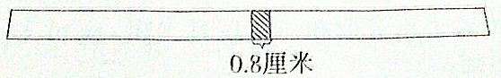

# Mathematics (Grade 3)

**ID**: 9e0c6133
**难度**: medium_hard
**题型**: short_answer

## 题目
淘淘把长12.6厘米的纸条和长11.08厘米的纸条粘接成一条较长的纸条，重叠粘合处长0.8厘米（如图），粘接后的纸条长多少厘米？

## 解答

**答案**: 22.88

1. Step1:计算两条纸条不重叠时的总长度，12.6 + 11.08 = 23.68厘米
2. Step2:因为有0.8厘米的重叠部分是重复计算的，所以用总长度减去重叠部分的长度，23.68 - 0.8 = 22.88厘米

## 知识点

**知识点**:
  - 整数、小数复合应用题

---
