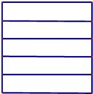

# Mathematics (Grade 3)

**ID**: 9f55ccf1
**难度**: medium_hard
**题型**: short_answer

## 题目
小红把一张边长30厘米的正方形纸片，剪成5张同样大的长方形纸片（如图），每张长方形纸片的周长是多少厘米？

## 解答

**答案**: 72

1. Step1:根据题意可知正方形边长为30厘米，要剪成5张同样大的长方形纸片，所以用正方形边长30厘米除以5，得到长方形的宽为30÷5 = 6厘米
2. Step2:已知长方形的长等于正方形的边长为30厘米，宽为6厘米，根据长方形周长公式（长+宽）×2，可得长方形周长为(30 + 6)×2
3. Step3:先计算括号内30 + 6 = 36厘米
4. Step4:再计算36×2 = 72厘米，即每张长方形纸片的周长是72厘米

## 知识点

**知识点**:
  - 长方形的周长．

---
