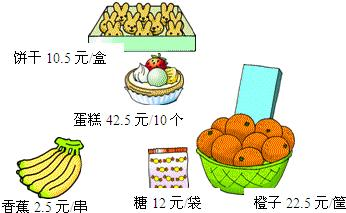

# Mathematics (Grade 3)

**ID**: a3cfc656
**难度**: medium_hard
**题型**: short_answer

## 题目
过年了，旺仔超市送给顾客一批购物券，每张券的面值100元．超市规定：每次只能使用一张购物券，购物不满100元的不找钱，超过100元需要补上差价．
如果你有一张这样的券，你怎样购买物品最合算？(在不补钱的情况下)

## 解答

**答案**: 购买4筐橙子和4串香蕉最合算

1. Step1:明确题目要求是在不补钱的情况下，用100元面值购物券购买物品最合算，即要使购买物品的总价恰好为100元
2. Step2:观察各物品价格，橙子22.5元/筐，香蕉2.5元/串，考虑将它们组合
3. Step3:计算(22.5 + 2.5)×4 = 25×4 = 100元，发现购买4筐橙子和4串香蕉总价为100元
4. Step4:得出购买4筐橙子和4串香蕉最合算的结论

## 知识点

**知识点**:
  - 最优化问题．

---
