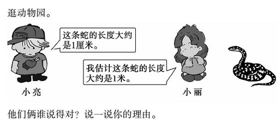

# Mathematics (Grade 3)

**ID**: a549ff7a
**难度**: medium_hard
**题型**: short_answer

## 题目

逛动物园。
小亮：这条蛇的长度大约是1厘米。
小丽：我估计这条蛇的长度大约是1米。
他们俩谁说得对？说一说你的理由。

## 解答

**答案**: 小丽说得对。

1. Step1:明确1厘米大约是一个指甲的宽度，是较短的长度单位
2. Step2:明确1米等于100厘米，是用来表示较长距离的长度单位
3. Step3:观察图中蛇的长度，发现其远大于一个指甲的宽度
4. Step4:根据实际情况判断，蛇的长度应该用米来度量，所以小丽说得对

## 知识点

**知识点**:
  - 长度单位的认识、进率及换算

---
