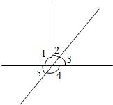

# Mathematics (Grade 3)

**ID**: a696ef53
**难度**: medium_hard
**题型**: short_answer

## 题目
算出图中各角的度数．

已知：∠1=90°，∠2=40°
求：∠3、∠4、∠5各是多少度．

## 解答

**答案**: 50°, 130°, 50°

1. Step1:因为∠1、∠2和∠3组成一个平角，平角为180°，已知∠1=90°，∠2=40°，所以∠3=180° - ∠1 - ∠2=180° - 90° - 40°=50°
2. Step2:因为∠3和∠4组成一个平角，平角为180°，∠3=50°，所以∠4=180° - ∠3=180° - 50°=130°
3. Step3:因为∠4和∠5组成一个平角，平角为180°，∠4=130°，所以∠5=180° - ∠4=180° - 130°=50°

## 知识点

**知识点**:
  - 线段与角的综合

---
