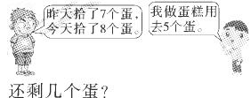

# Mathematics (Grade 3)

**ID**: a7d600dc
**难度**: medium_hard
**题型**: short_answer

## 题目

昨天拾了7个蛋，今天拾了8个蛋。
我做蛋糕用去5个蛋。
还剩几个蛋？

## 解答

**答案**: 10

1. Step1:计算昨天和今天拾的蛋的总数，即7 + 8 = 15个
2. Step2:用蛋的总数减去做蛋糕用去的个数，即15 - 5 = 10个

## 知识点

**知识点**:
  - 整数复合应用题

---
