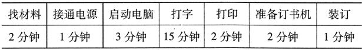

# Mathematics (Grade 3)

**ID**: abdd5ddb
**难度**: medium_hard
**题型**: short_answer

## 题目
王老师要用电脑打一篇文章，他要做下面几件事．

至少要用多少时间？顺序是怎样的？     

## 解答

**答案**: 22, 接通电源(1分钟)→启动电脑(3分钟)(同时可以找材料)→打字(15分钟)→打印(2分钟)(同时准备订书机)→装订(1分钟)

1. Step1:分析各项任务，确定可并行任务。启动电脑3分钟时间内可同时找材料2分钟，打印2分钟时间内可同时准备订书机2分钟。
2. Step2:确定任务顺序为接通电源(1分钟)→启动电脑(3分钟)(同时可以找材料)→打字(15分钟)→打印(2分钟)(同时准备订书机)→装订(1分钟)。
3. Step3:计算总时间，1+3+15+2+1=22分钟。
4. Step4:得出至少要用22分钟，顺序为接通电源(1分钟)→启动电脑(3分钟)(同时可以找材料)→打字(15分钟)→打印(2分钟)(同时准备订书机)→装订(1分钟)。

## 知识点

**知识点**:
  - 最佳方法问题．

---
