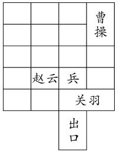

# Mathematics (Grade 3)

**ID**: b210a810
**难度**: medium_hard
**题型**: short_answer

## 题目
怎样移动图中的人物，才能让曹操从华容道逃走？

## 解答

**答案**: 关羽向左移两格, 兵向右移一格, 曹操向左移动1格, 再向下移动5格

1. Step1:观察图形可知曹操占2个格，且只能横向或纵向移动
2. Step2:发现堵住曹操道路的是兵和关羽
3. Step3:确定要移动关羽和兵，为曹操让出通道
4. Step4:得出关羽向左移两格，为曹操让出横向空间
5. Step5:得出兵向右移一格，进一步调整通道空间
6. Step6:曹操向左移动1格，进入腾出的横向空间
7. Step7:曹操再向下移动5格，到达出口从而逃走

## 知识点

**知识点**:
  - 平移

---
