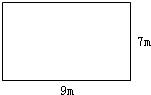

# Mathematics (Grade 3)

**ID**: b2e4eeae
**难度**: medium_hard
**题型**: short_answer

## 题目
一种地板每平方米的售价是60元．给一间计算机教室的地面（如图）铺上这种地板，大约一共需要多少元？

## 解答

**答案**: 3780

1. Step1:根据长方形面积公式s=ab，其中a=9m，b=7m，可得教室地面面积为9×7 = 63平方米
2. Step2:已知地板每平方米售价60元，根据单价×数量=总价，数量为教室地面面积63平方米，所以总价为60×63 = 3780元

## 知识点

**知识点**:
  - 长方形、正方形的面积

---
