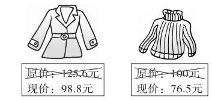

# Mathematics (Grade 3)

**ID**: be2e144b
**难度**: medium_hard
**题型**: short_answer

## 题目
妈妈在服装区买了下面的两件衣服，一共便宜了多少元？

## 解答

**答案**: 50.3

1. Step1:计算第一件衣服便宜的金额，用原价125.6元减去现价98.8元，即125.6 - 98.8 = 26.8元
2. Step2:计算第二件衣服便宜的金额，用原价100元减去现价76.5元，即100 - 76.5 = 23.5元
3. Step3:将两件衣服便宜的金额相加，26.8 + 23.5 = 50.3元

## 知识点

**知识点**:
  - 小数的加法和减法

---
