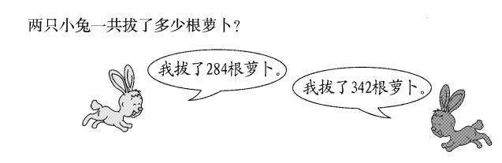

# Mathematics (Grade 3)

**ID**: c001a888
**难度**: medium_hard
**题型**: short_answer

## 题目

两只小兔一共拔了多少根萝卜？
我拔了284根萝卜。
我拔了342根萝卜。

## 解答

**答案**: 626

1. Step1:明确问题是求两只小兔拔萝卜数量的总和
2. Step2:已知一只小兔拔了284根萝卜，另一只小兔拔了342根萝卜
3. Step3:根据加法的意义，将两只小兔拔的萝卜数相加，即284 + 342
4. Step4:计算284 + 342的结果为626

## 知识点

**知识点**:
  - 整数的加法和减法

---
