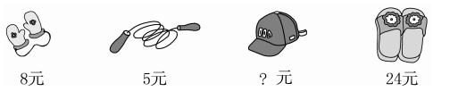

# Mathematics (Grade 3)

**ID**: c309b727
**难度**: medium_hard
**题型**: short_answer

## 题目

1.买3双手套需多少元钱？
2.2根跳绳的价钱和帽子的价钱相符，帽子多少元钱？
3.王阿姨带的钱可买5双手套，王阿姨带了多少钱？

## 解答

**答案**: 24, 10, 40

1. Step1:已知手套单价为8元，求买3双手套的价钱，根据单价×数量＝总价，可得8×3=24元
2. Step2:已知跳绳单价为5元，2根跳绳的价钱和帽子的价钱相符，根据单价×数量＝总价，可得5×2=10元
3. Step3:已知手套单价为8元，王阿姨带的钱可买5双手套，根据单价×数量＝总价，可得8×5=40元

## 知识点

**知识点**:
  - 整数乘法应用题

---
