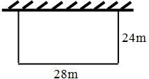

# Mathematics (Grade 3)

**ID**: cb370ecb
**难度**: medium_hard
**题型**: short_answer

## 题目
一个长方形的露天养鸡场，有一个长边靠墙，其他三边用竹篱笆围起来，这个养鸡场的长为28米，宽24米．
(1)竹篱笆有多长？
(2)如果不靠墙，用这个竹篱笆围一块正方形菜地，菜地面积有多少平方米？

## 解答

**答案**: 76, 361

1. Step1:根据篱笆一边靠墙，计算竹篱笆长度，即28 + 24×2 = 28 + 48 = 76米
2. Step2:用竹篱笆长度76米除以4，得到围成正方形的边长为76÷4 = 19米
3. Step3:根据正方形面积公式，计算菜地面积为19×19 = 361平方米

## 知识点

**知识点**:
  - 长方形的周长;长方形、正方形的面积．

---
