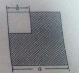

# Mathematics (Grade 3)

**ID**: d114a51a
**难度**: medium_hard
**题型**: short_answer

## 题目
如图，a、b分别为大、小亮哥正方形的边长。
 （1）用含有字母的式子表示图中阴影部分的面积
 （2）如果a=6厘米，b=3厘米，那么阴影部分的面积是多少平方厘米？

 b
 a

## 解答

**答案**: a²-b², 27

1. Step1:根据图形可知，阴影部分面积等于大正方形面积减去小正方形面积，大正方形面积为a²，小正方形面积为b²，所以阴影部分面积用式子表示为a² - b²
2. Step2:已知a=6厘米，b=3厘米，将其代入a² - b²，得到6² - 3²
3. Step3:计算6² - 3²，6²=36，3²=9，36 - 9 = 27，所以此时阴影部分面积为27平方厘米

## 知识点

**知识点**:
  - 

---
