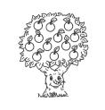

# Mathematics (Grade 3)

**ID**: d1e37f30
**难度**: medium_hard
**题型**: short_answer

## 题目
李大伯在2公顷的山坡上种苹果树。每棵苹果树的占地面积是8平方米，每棵苹果树可以收苹果40千克。那么这些树共可以收多少千克苹果？

## 解答

**答案**: 100000

1. Step1:将2公顷换算为平方米，因为1公顷=10000平方米，所以2公顷 = 2×10000 = 20000平方米
2. Step2:计算山坡上苹果树的棵数，用山坡面积除以每棵苹果树占地面积，即20000÷8 = 2500棵
3. Step3:计算这些苹果树共收苹果的重量，用苹果树的棵数乘以每棵树的产量，即2500×40 = 100000千克

## 知识点

**知识点**:
  - 整数乘除法的混合运算;面积单位的认识、进率及换算

---
