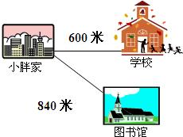

# Mathematics (Grade 3)

**ID**: d3e517c9
**难度**: medium_hard
**题型**: short_answer

## 题目
小胖从家到学校相距600米步行需要走10分钟，如果他用同样的速度，从家到图书馆最少要走多少分钟？

## 解答

**答案**: 14

1. Step1:根据路程÷时间=速度，计算小胖的速度，即600÷10 = 60（米/分钟）
2. Step2:已知从家到图书馆的距离为840米，用从家到图书馆的距离除以小胖的速度，即840÷60 = 14（分钟），得到从家到图书馆最少要走的时间

## 知识点

**知识点**:
  - 简单的行程问题．

---
