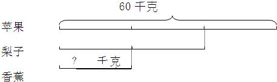

# Mathematics (Grade 3)

**ID**: e012e4ef
**难度**: medium_hard
**题型**: short_answer

## 题目
看图计算解答

## 解答

**答案**: 20

1. Step1:根据图示可知，梨子的重量是苹果重量的$\frac{2}{3}$，苹果重60千克，所以梨子的重量为60×$\frac{2}{3}$=40千克
2. Step2:又因为香蕉重量是梨子重量的$\frac{1}{2}$，梨子重40千克，所以香蕉的重量为40×$\frac{1}{2}$=20千克

## 知识点

**知识点**:
  - 图文应用题．

---
