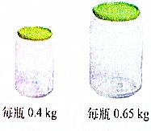

# Mathematics (Grade 3)

**ID**: e07c253f
**难度**: medium_hard
**题型**: short_answer

## 题目
淘气的妈妈要将2.6kg油分装在一些玻璃瓶，如果都装在小瓶里，至少需要准备几个小瓶？要是都装在大瓶里呢？

## 解答

**答案**: 7, 4

1. Step1:明确要装的油的总重量为2.6kg，小瓶容量为0.4kg，根据除法意义，用总重量除以小瓶容量，即2.6÷0.4=6.5
2. Step2:因为瓶子个数必须为整数，6个小瓶装不完，所以对6.5向上取整得到7，即至少需要7个小瓶
3. Step3:明确大瓶容量为0.65kg，用总重量除以大瓶容量，即2.6÷0.65=4
4. Step4:4为整数，所以至少需要4个大瓶

## 知识点

**知识点**:
  - 整数、小数复合应用题

---
