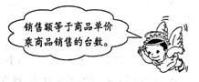

# Mathematics (Grade 3)

**ID**: e3314480
**难度**: medium_hard
**题型**: short_answer

## 题目
下面是某电器商场5月1日这天三种电器的销售情况。
$\begin{array}{|c|c|c|c|}
\hline
种类
 & 冰箱
 & 微波炉
 & 洗衣机
 \\\hline
台数
 & 3
 & 6
 & 9
 \\\hline
\end{array}$
（1）冰箱的单价是860元，当天冰箱的销售额是多少元？

（2）洗衣机的单价是699元，当天洗衣机的销售额是多少元？

## 解答

**答案**: 2580元, 6291元

1. Step1:根据题目可知冰箱单价为860元，销售台数为3台，由销售额等于商品单价乘商品销售的台数，可得冰箱销售额为860×3
2. Step2:计算860×3的结果为2580元
3. Step3:根据题目可知洗衣机单价为699元，销售台数为9台，由销售额等于商品单价乘商品销售的台数，可得洗衣机销售额为699×9
4. Step4:计算699×9的结果为6291元

## 知识点

**知识点**:
  - 小学数学;数与代数;应用题;常见的数学问题;经济问题;简单应用题;整数简单应用题

---
