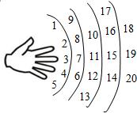

# Mathematics (Grade 3)

**ID**: e4173e83
**难度**: medium_hard
**题型**: short_answer

## 题目
小明在按如图练习数数，由上向下的手指分别为大拇指、食指、中指、无名指和小指．问2012在哪个指上？

## 解答

**答案**: 无名指

1. Step1:明确数数顺序为大拇指、食指、中指、无名指、小指、无名指、中指、食指，依次循环
2. Step2:总结出大拇指对应的数是1+8n，食指对应的数是2+8n，中指对应的数是3+8n，无名指对应的数是4+8n，小指对应的数是5+8n的规律
3. Step3:计算2012÷8=251…4
4. Step4:将2012表示为2012=8×251+4
5. Step5:根据规律得出2012在无名指上

## 知识点

**知识点**:
  - 简单周期现象中的规律．

---
