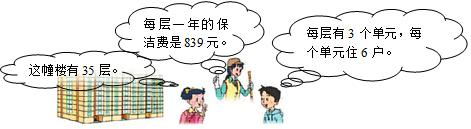

# Mathematics (Grade 3)

**ID**: ec1b0704
**难度**: medium_hard
**题型**: short_answer

## 题目

（1）这幢楼一共住多少户？
（2）这幢楼一年的保洁费一共多少元？

## 解答

**答案**: 630, 29365

1. Step1:先计算每层的住户数量，因为每层有3个单元，每个单元住6户，所以每层住户数为6×3 = 18户
2. Step2:再计算这幢楼的住户总数，已知这幢楼有35层，每层18户，所以住户总数为18×35 = 630户
3. Step3:计算这幢楼一年的保洁费，已知每层一年的保洁费是839元，这幢楼有35层，所以保洁费总数为839×35 = 29365元

## 知识点

**知识点**:
  - 整数的乘法及应用

---
