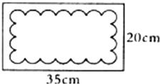

# Mathematics (Grade 3)

**ID**: efe98bed
**难度**: medium_hard
**题型**: short_answer

## 题目
如图所示的是一份体育小报，它的面积是多少平方厘米？合多少平方分米？如果给它的四周镶一道花边，花边的长是多少厘米？     

## 解答

**答案**: 700, 7, 110

1. Step1:根据长方形面积公式，体育小报面积为长35厘米乘以宽20厘米，即35×20 = 700平方厘米
2. Step2:因为1平方分米 = 100平方厘米，所以将700平方厘米换算为平方分米，700÷100 = 7平方分米
3. Step3:根据长方形周长公式，花边长度为(长35厘米 + 宽20厘米)×2，即(35 + 20)×2 = 55×2 = 110厘米

## 知识点

**知识点**:
  - 长方形的周长;长方形、正方形的面积．

---
