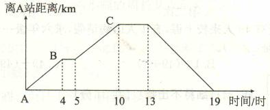

# Mathematics (Grade 3)

**ID**: f3384edf
**难度**: medium_hard
**题型**: short_answer

## 题目
电车从$\textit{A}$站经过$\textit{B}$站到达$\textit{C}$站，然后返回．去时在$\textit{B}$站停车，而返回时$\textit{B}$站不停．去时的车速是每小时48km．

(1)A站到C站的距离是多少千米？
(2)返回时的车速是每小时行多少千米？

## 解答

**答案**: 432千米, 72千米

1. Step1:分析去时行驶时间，从图中可知在B站停车1小时，去时从A到B用时4小时，从B到C用时5小时，所以去时行驶时间为4 + 5 = 9小时
2. Step2:根据速度×时间=路程，已知去时车速为每小时48千米，行驶时间为9小时，所以A站到C站的距离为48×(4 + 5)=432千米
3. Step3:分析返回用时，从图中可知从C出发到A共用19 - 13 = 6小时
4. Step4:根据路程÷时间=速度，A站到C站距离为432千米，返回用时6小时，所以返回时车速为432÷6 = 72千米

## 知识点

**知识点**:
  - 小学数学;数与代数;应用题;常见的数学问题;行程问题;数与形

---
