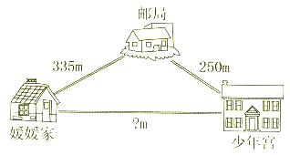

# Mathematics (Grade 3)

**ID**: f7d9ff93
**难度**: medium_hard
**题型**: short_answer

## 题目
媛媛从家出发，经过邮局到少年宫，一共用了9分。
（1）媛媛平均每分走多少米？

（2）如果照这样的速度直接从家到少年宫，只要7分。媛媛直接从家去少年宫的路程是多少米？

## 解答

**答案**: 65, 455

1. Step1:计算媛媛从家出发经过邮局到少年宫的总路程，335 + 250 = 585米
2. Step2:根据速度 = 路程÷时间，计算媛媛的速度，585÷9 = 65米/分
3. Step3:根据路程 = 速度×时间，计算媛媛直接从家去少年宫的路程，65×7 = 455米

## 知识点

**知识点**:
  - 简单的行程问题

---
