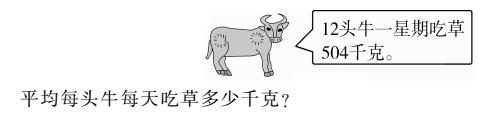

# Mathematics (Grade 3)

**ID**: f863c21d
**难度**: medium_hard
**题型**: short_answer

## 题目

12头牛一星期吃草504千克。
平均每头牛每天吃草多少千克？

## 解答

**答案**: 6

1. Step1:明确1星期等于7天
2. Step2:计算12头牛1天吃草的千克数，用总吃草量504千克除以7天，即504÷7 = 72千克
3. Step3:计算每头牛每天吃草的千克数，用12头牛1天吃草的72千克除以12头牛，即72÷12 = 6千克

## 知识点

**知识点**:
  - 简单的归一应用题

---
