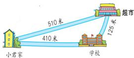

# Mathematics (Grade 3)

**ID**: fb489e64
**难度**: medium_hard
**题型**: short_answer

## 题目
如右图．李老师放学后从学校到小君家，家访后再到超市买菜回学校．李老师一共行了多少米？

## 解答

**答案**: 1045

1. Step1:明确李老师行走的第一段路程，从学校到小君家，距离是410米
2. Step2:明确李老师行走的第二段路程，从小君家到超市，距离是510米
3. Step3:明确李老师行走的第三段路程，从超市回学校，距离是125米
4. Step4:将三段路程相加，即410 + 510 + 125
5. Step5:先计算410 + 510 = 920
6. Step6:再计算920 + 125 = 1045，得到李老师一共行走的路程

## 知识点

**知识点**:
  - 图文应用题；整数的加法和减法．

---
