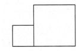

# Mathematics (Grade 3)

**ID**: fb61c655
**难度**: medium_hard
**题型**: short_answer

## 题目
下图由两个正方形组成，已知小正方形的面积是25平方厘米，大正方形的边长是小正方形边长的2倍。大正方形的面积是多少平方厘米？合多少平方分米？

## 解答

**答案**: 100平方厘米, 1平方分米

1. Step1:根据小正方形面积是25平方厘米，因为5×5 = 25，所以小正方形边长为5厘米
2. Step2:已知大正方形的边长是小正方形边长的2倍，所以大正方形边长为5×2 = 10厘米
3. Step3:根据正方形面积公式，大正方形面积为10×10 = 100平方厘米
4. Step4:因为1平方分米 = 100平方厘米，所以100平方厘米合1平方分米

## 知识点

**知识点**:
  - 小学数学;图形与几何

---
