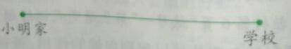

# Mathematics (Grade 3)

**ID**: fb905bc3
**难度**: medium_hard
**题型**: short_answer

## 题目
小明家与学校的距离大约是2.4km，小明骑车去上学走了全长的
 $\frac{3}{4}$
  ， 距中点有多远？距终点呢？（请在图中标出小明现在的大致位置）

## 解答

**答案**: 0.6, 0.6

1. Step1:计算小明骑车走的距离，2.4×(3/4)=1.8千米
2. Step2:计算全长的中点距离，2.4÷2 = 1.2千米
3. Step3:计算小明距中点的距离，1.8 - 1.2 = 0.6千米
4. Step4:计算小明距终点的距离，2.4 - 1.8 = 0.6千米

## 知识点

**知识点**:
  - --

---
