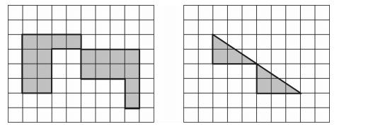

# Mathematics (Grade 3)

**ID**: fc464c5e
**难度**: medium_hard
**题型**: short_answer

## 题目
观察下面每组图形，先说说怎样才能使每组的图形变成一个长方形，再计算长方形的面积（每个小正方形的边长为1cm）。

## 解答

**答案**: 20, 6

1. Step1:分析图形1，确定将右边图形绕着2个阴影部分的公共端点顺时针旋转90°可组成长方形，此时长方形长为5cm，宽为4cm
2. Step2:根据长方形面积公式S = 长×宽，计算图形1组成的长方形面积，即4×5 = 20cm²
3. Step3:分析图形2，确定将下面三角形绕着2个三角形的公共端点逆时针旋转180°可组成长方形，此时长方形长为3cm，宽为2cm
4. Step4:根据长方形面积公式S = 长×宽，计算图形2组成的长方形面积，即3×2 = 6cm²
5. Step5:将两个长方形面积20cm²和6cm²提取出数值20和6组成列表

## 知识点

**知识点**:
  - 长方形与正方形的面积;图形的旋转

---
