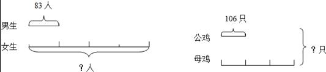

# Mathematics (Grade 3)

**ID**: fcdeaf0d
**难度**: medium_hard
**题型**: short_answer

## 题目
看图列式并列式

## 解答

**答案**: 332, 424

1. Step1:根据图中信息，男生有83人，女生人数是男生的4倍，所以女生人数为83×4 = 332人
2. Step2:根据图中信息，公鸡有106只，母鸡的只数是公鸡的3倍，先算出母鸡只数为106×3 = 318只
3. Step3:计算鸡的总数，用母鸡只数318只加上公鸡只数106只，即318 + 106 = 424只

## 知识点

**知识点**:
  - 图文应用题

---
