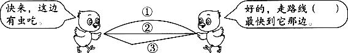

# Mathematics (Grade 3)

**ID**: 0022a596
**难度**: medium
**题型**: multiple_choice

## 题目
小鸡找虫。 

A．①
B．②
C．③

## 解答

**答案**: B

1. Step1:根据数学原理，两点之间线段最短。
2. Step2:观察图中三条路线，路线②是线段。
3. Step3:所以走路线②最快，答案选B。

## 知识点

**知识点**:
  - 

---
