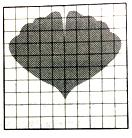

# Mathematics (Grade 3)

**ID**: 052495ac
**难度**: medium
**题型**: multiple_choice

## 题目
如图：树叶的面积约是(     )。(每个小方格的面积是1cm$^{2}$

A．15cm^{2}\sim25cm^{2}
B．35cm^{2}\sim45cm^{2}
C．55cm^{2}\sim65cm^{2}

## 解答

**答案**: B

1. Step1:数满格的小方格数量，发现有28个满格。
2. Step2:数不满格的小方格数量，有34个不满格。
3. Step3:将不满格的按半格计算，34个不满格相当于34÷2 = 17个满格。
4. Step4:计算树叶大约的方格数，28 + 17 = 45个。
5. Step5:因为每个小方格面积是1cm²，所以树叶面积约是45cm²，其在35cm²～45cm²这个范围，答案选B。

## 知识点

**知识点**:
  - 小学数学;图形与几何;平面图形;不规则图形的面积

---
